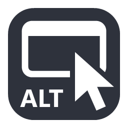

<p align="center">
  
</p>

<h1 align="center">AltSnap Lite</h1>

<p align="center">
  <b>Move, resize, snap and pin any window with Alt + mouse.</b><br>
  A tiny, fast tray app for Windows 10 and 11. One portable EXE, no installer.
</p>

<p align="center">
  <a href="https://github.com/svenbuild/altsnap-lite/releases/latest"></a>
  <a href="https://github.com/svenbuild/altsnap-lite/actions/workflows/build.yml"></a>
  <a href="LICENSE"></a>
</p>

<p align="center">
  
  
</p>

**[Deutsch weiter unten](#deutsch)**

## Why

Grabbing a window by its tiny title bar is slow. With AltSnap Lite you hold **Alt** and grab the window *anywhere*: move it, resize it from the nearest edge, throw it to a screen edge to snap it, or pin it on top. It works on every monitor and respects the taskbar.

## Gestures

| Hold Alt and … | Result |
| --- | --- |
| drag with the **left** button | Move the window from anywhere |
| drag with the **right** button | Resize from the nearest side or corner |
| **double click** left | Maximize, or restore if maximized |
| **double click** right | Minimize |
| click the **middle** button (wheel) | Toggle "always on top"; pinned windows get a colored frame |
| drag to the **left / right** edge | Snap to the left / right half |
| drag into a **corner** | Snap to a quarter |
| drag to the **top** edge | Maximize |

A preview shows where the window will land. Snapped or maximized windows can be pulled out again with Alt + drag and get their old size back.

## Install

1. Download **`AltSnapLite.exe`** from the [latest release](https://github.com/svenbuild/altsnap-lite/releases/latest).
2. Put it in a folder of your choice (for example `%LOCALAPPDATA%\Programs\AltSnap Lite`) and start it.
3. The icon appears in the tray (maybe behind **^**). Click it to open the settings.

The EXE is self-contained (the .NET runtime is included), so nothing else needs to be installed. It is not code-signed; if Windows SmartScreen asks, choose *More info → Run anyway*.

## Features

- **Silent automatic updates.** Every 6 hours AltSnap Lite checks GitHub Releases. A new version is downloaded, verified with its SHA-256 checksum, swapped in while no gesture is active and restarted in the background. Turn it off with *Update automatically*. Updates need write access to the EXE's folder, so keep it in a user folder rather than `Program Files`. If a new version fails to start, AltSnap Lite returns to the previous one and skips that version.
- **Your own gesture key.** Alt is the default. Click the key in the settings and press another one: Ctrl, Shift, Win, Caps Lock, Scroll Lock, Pause, Insert, the Menu key or F1 to F24, also combined like Ctrl + Alt. Keys like Caps Lock then only work for AltSnap Lite.
- **Light and dark mode**, following your Windows setting.
- **English and German**, following your Windows display language.
- **Start with Windows** for the current user, without admin rights.
- **Pause** from the tray menu; the tray icon turns gray.
- Settings are saved instantly to `%LOCALAPPDATA%\AltSnapLite\settings.json`.

## Good to know

- To control windows of programs that run as administrator, start AltSnap Lite as administrator too. Windows does not allow it otherwise.
- Windows with a fixed size can be moved but not resized or snapped.
- Starting the EXE a second time just opens the settings of the running instance.
- AltSnap Lite is an independent project inspired by [AltSnap](https://github.com/RamonUnch/AltSnap). It shares no code with it.

## Build from source

Requires Windows and the [.NET 10 SDK](https://dotnet.microsoft.com/download).

```powershell
./build.ps1                       # self-contained EXE in dist/
./build.ps1 -FrameworkDependent   # small EXE, needs the .NET 10 Desktop Runtime
dotnet run --project tests/AltSnapLite.Tests                   # unit tests
dotnet run --project tests/AltSnapLite.Tests -- --integration  # also opens real test windows
```

A release is published by pushing a tag like `v1.1.0`; GitHub Actions builds, tests and uploads the EXE. The tag must match `<Version>` in `src/AltSnapLite/AltSnapLite.csproj`, and `CHANGELOG.md` needs a section for it.

## License

[GPL-3.0](LICENSE)

---

## Deutsch

**AltSnap Lite** steuert Fenster mit Alt + Maus: verschieben, Grösse ändern, einrasten und im Vordergrund anheften. Eine kleine portable EXE für Windows 10 und 11, ohne Installation.

| Alt halten und … | Ergebnis |
| --- | --- |
| mit der **linken** Taste ziehen | Fenster an beliebiger Stelle verschieben |
| mit der **rechten** Taste ziehen | Grösse von der nächsten Seite oder Ecke aus ändern |
| **Doppelklick** links | Maximieren bzw. wiederherstellen |
| **Doppelklick** rechts | Minimieren |
| **Mittelklick** (Mausrad) | „Immer im Vordergrund“ an / aus, mit farbigem Rahmen |
| an den **linken / rechten** Rand ziehen | Auf die linke / rechte Hälfte einrasten |
| in eine **Ecke** ziehen | Auf ein Viertel einrasten |
| an den **oberen** Rand ziehen | Maximieren |

**Installation:** `AltSnapLite.exe` aus dem [neuesten Release](https://github.com/svenbuild/altsnap-lite/releases/latest) laden, in einen eigenen Ordner legen und starten. Das Symbol erscheint im Infobereich der Taskleiste; ein Klick darauf öffnet die Einstellungen.

**Updates** kommen automatisch und still: alle 6 Stunden wird auf GitHub nachgesehen, eine neue Version geladen, per SHA-256 geprüft und im Hintergrund neu gestartet. Abschaltbar mit *Automatisch aktualisieren*. Dafür braucht die App Schreibrechte im Ordner der EXE, also besser nicht unter `Programme` ablegen.

**Andere Taste statt Alt:** In den Einstellungen auf die Taste klicken und die neue drücken. Möglich sind Strg, Umschalt, Win, CapsLock, Rollen, Pause, Einfg, Menütaste und F1 bis F24, auch kombiniert wie Strg + Alt.

Die Oberfläche ist deutsch, wenn Windows auf Deutsch eingestellt ist, sonst englisch. Hell und dunkel folgen der Windows-Einstellung. Programme, die als Administrator laufen, lassen sich nur steuern, wenn AltSnap Lite ebenfalls als Administrator läuft.
